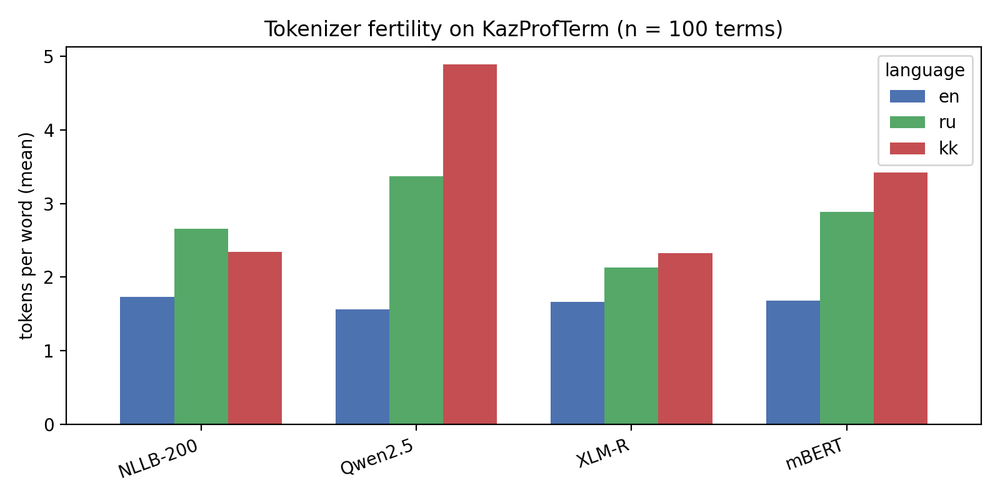

# KazProfTerm

**A trilingual Kazakh / Russian / English terminology resource for three vocational specialties:
IT technician, electrician, cook.**

> Status: **v0.1** — 100 terms (≈33 per specialty), no definitions yet.

## Why

Our earlier study showed that LLM judges score Kazakh interview answers against **English** reference
points. KazProfTerm provides **Kazakh** terms for the same three specialties, so that reference points
can be written in Kazakh, and we can test whether the reference-point language changes the
Kazakh–Russian scoring gap (SkillBridge integration, v1.0).

_Links: paper (arXiv — TBA), HF Dataset (TBA), SkillBridge (TBA)._

## Repository layout

```
data/
  terms.csv        # main table — the only file edited by hand
  sources.csv      # sources referenced by terms.csv (source_kk)
  evidence.csv     # per-term source records: source id, clause (п.), exact search/document URL
  open_issues.csv  # decisions still pending (type changes, draft terms, reviewer comments)
  iaa_sample.csv   # blind random sample 20/20/20 for the second annotator (v0.5)
  sentences.csv    # English sentences containing terms (v0.5)
  expert_review_E01_it.csv          # IT teacher's ratings and comments (anonymised)
  expert_review_E02_electrical.csv  # electrical teacher's handwritten translations, transcribed
  expert_review_E03_cook.csv        # cook teacher's oral review of all 33 culinary terms
  raw/             # frozen input versions (hand-checked table of 2026-11-12), not edited
notebooks/
  01_tokenizers.ipynb      # v0.1
  02_eval_models.ipynb     # v0.5
  03_agreement.ipynb       # v0.5
  04_export_ontolex.ipynb  # v1.0
scripts/validate_terms.py  # run before every commit
export/       # terms.json, terms.ttl (generated)
results/      # tables and figures (generated)
skillbridge/  # glossary prompt + experiment script (v1.0)
report/       # report.pdf (v1.0)
```

Check the data before every commit:

```bash
python3 scripts/validate_terms.py
```

## Columns of `terms.csv`

| Column | Values / example | Required in v0.1 |
|---|---|---|
| `id` | `T0001` | yes |
| `specialty` | `electrician` / `cook` / `it_technician` | yes |
| `category` | `tool` / `material` / `process` / `safety` / `equipment` / `concept` | yes |
| `en` | circuit breaker | yes |
| `ru` | автоматический выключатель | yes |
| `kk` | main Kazakh term (Cyrillic) | yes |
| `kk_variants` | other attested variants, separated by `;` | recommended |
| `kk_latn` | Latin script (2021 alphabet) | no |
| `pos` | `noun` / `noun phrase` / `verb` / `verb phrase` / `adjective` | yes |
| `term_type` | `calque` / `borrowing` / `native` / `hybrid` | yes |
| `source_kk` | source id(s) from `sources.csv`, e.g. `S03` or `S03;S07` | yes |
| `status` | `verified` / `expert_checked` / `draft` | yes |
| `in_skillbridge` | `yes` / `no` | yes |
| `definition_en` | own words | v0.5+ |
| `definition_kk` | own words | v1.0 (≥ 50) |
| `wikidata` | `Q…` or empty | v1.0 |
| `notes` | free text | no |

## Annotation guidelines

### Status

| Status | Rule |
|---|---|
| `verified` | The Kazakh term is attested in an authoritative source (State Terminology Commission, a dictionary, a Kazakh-language college textbook). `source_kk` must point to it. |
| `expert_checked` | A subject teacher (college instructor in that specialty) confirmed that the term is used in class. Stronger than `verified`. |
| `draft` | Proposed by the author; no source found. `notes` must explain the choice. **Excluded from model evaluation.** |

Kazakh and Russian equivalents and their source links were collected **manually by the author** from the listed sites (Termincom search, adilet.zan.kz parallel texts, textbooks); each link in `evidence.csv` points to the page where the pair was found.

Kazakh Wikipedia alone is **not** enough for `verified`. Authoritative sources for `source_kk`:
Termincom (S01), parallel RU/KK legal acts on adilet.zan.kz (S03–S06), Kazakh-language textbooks (S07).

`verified` requires the **whole** term to be attested. If only its parts are attested
(e.g. «коммутатор» is in Termincom but «желілік коммутатор» is not), the term stays `draft` and
`notes` starts with `component-only:`.

`notes` format: `<evidence summary> | v2: <verification comment>`. Exact URLs and clause numbers
are in `evidence.csv`, not in `terms.csv`.

Kazakh and Russian terms are written in lower case (except abbreviations: IP, ХАССП).

### Term type (`term_type`)

The type describes **the Kazakh term in the `kk` column** (not the variants). Decide by looking at
each component of the term:

| Type | Rule | Examples |
|---|---|---|
| `borrowing` | All meaningful components are taken from another language (usually Russian or international vocabulary), with at most phonetic/spelling adaptation. | компьютер, кабель, розетка, сервер |
| `calque` | All components are Kazakh, and the term reproduces the structure of a foreign (usually Russian) term word-by-word or morpheme-by-morpheme. | қысқа тұйықталу (← короткое замыкание), жылу өткізгіштік (← теплопроводность) |
| `native` | All components are Kazakh and the term does **not** mirror a foreign term's structure: traditional words and independently motivated new coinages. | пышақ (knife), тұз (salt), қазан (cauldron) |
| `hybrid` | At least one borrowed component **and** at least one Kazakh component (including a Kazakh suffix on a borrowed stem that forms a new word). | электр сымы, желілік кабель, автоматты ажыратқыш |

Decision order for difficult cases:

1. Any borrowed component + any Kazakh component → `hybrid`.
2. Only borrowed components → `borrowing`. Inflectional endings (case, possessive) do not count as a Kazakh component.
3. Only Kazakh components → `calque` if a component-by-component match with the Russian (or English) term exists, otherwise `native`.
4. Single-word Kazakh neologism (e.g. бағдарлама): `calque` only if its morphemes clearly mirror the source word's morphemes; otherwise `native`. Write the reason in `notes`.

> These guidelines are fixed **before** annotation. If they change, record the change and the date
> here, and re-check already annotated terms.

### Variants (`kk_variants`)

Record every Kazakh variant attested in a source or in teachers' usage (e.g. a borrowing next to a
calque). Model outputs are counted as correct if they match `kk` **or** any variant.

`kk` holds the form **used in practice**, as confirmed by subject teachers; when the
Termincom-approved (normative) form differs, it is kept in `kk_variants`
(e.g. `kk = маршрутизатор`, `kk_variants = бағдарғылауыш;…`). If no teacher has reviewed a term,
`kk` is the form attested in the sources.
Variants are stored as attested forms of the same entry, not as separate entries.

## Current state (2026-11-12)

| | count |
|---|---|
| Terms | 100 (IT 34, electrician 33, cook 33) |
| `verified` / `expert_checked` / `draft` | 26 / 70 / 4 |
| `term_type`: calque / hybrid / native / borrowing | 43 / 28 / 15 / 14 |
| In SkillBridge questions | 82 |
| Open issues | see `data/open_issues.csv` |

`data/terms.csv` was built once from the hand-checked table in `data/raw/` with
`scripts/build_terms.py`; from now on it is edited directly.

## Sources and copyright

Dictionaries are **not** copied wholesale: only individual terms with a reference to the source.
All definitions are written in our own words.

## Results

### Tokenization (v0.1)

Tokens per term (mean) and fertility (tokens per word) on 100 terms; special tokens not counted.

| Tokenizer | tokens EN | tokens RU | tokens KK | fertility EN | fertility RU | fertility KK | KK / EN |
|---|---|---|---|---|---|---|---|
| NLLB-200 | 2.56 | 4.46 | 4.28 | 1.73 | 2.66 | 2.34 | 1.84 |
| XLM-R | 2.46 | 3.58 | 4.31 | 1.66 | 2.13 | 2.33 | 1.86 |
| mBERT | 2.50 | 4.85 | 6.38 | 1.68 | 2.89 | 3.42 | 2.79 |
| Qwen2.5 | 2.28 | 5.68 | 9.56 | 1.56 | 3.37 | 4.89 | 4.43 |



On our sample, a Kazakh term takes on average 1.8× (NLLB-200, XLM-R) to 4.4× (Qwen2.5) as many tokens as
its English equivalent. The general-purpose LLM tokenizer often falls back to single bytes for
Kazakh-specific letters. Native Kazakh terms are split more finely than borrowings in every model.
This is a descriptive result (n = 100); KazLLM (ISSAI) is not included because its repository is gated.

## License

Code: MIT. Data (`data/`, `export/`): [CC BY 4.0](https://creativecommons.org/licenses/by/4.0/).

## Citation

_TBA._
