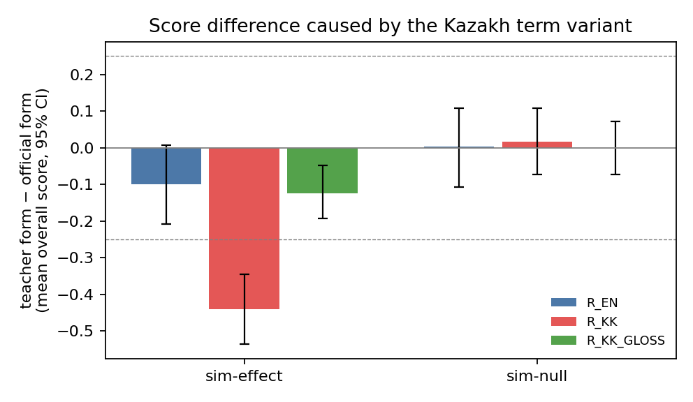

# Results: run `pilot_sim`

Judges: sim-effect, sim-null. Requests: 3000, ok: 3000.

## Primary and secondary hypotheses (item level, n = items)

`mean` is the mean of d = score(teacher form) − score(official form); negative = teacher's term penalised.

| judge      | contrast                    |   n_items |   mean |   ci95_low |   ci95_high |   p_wilcoxon |   p_tost_0.25 |   p_holm |
|:-----------|:----------------------------|----------:|-------:|-----------:|------------:|-------------:|--------------:|---------:|
| sim-effect | H1: d(R_KK)                 |        25 | -0.440 |     -0.536 |      -0.344 |        0.000 |         1.000 |    0.000 |
| sim-effect | H2: d(R_KK) - d(R_EN)       |        25 | -0.340 |     -0.488 |      -0.180 |        0.001 |       nan     |    0.002 |
| sim-effect | H3: d(R_KK_GLOSS) - d(R_KK) |        25 |  0.316 |      0.188 |       0.444 |        0.001 |       nan     |    0.001 |
| sim-effect | descr: d(R_EN)              |        25 | -0.100 |     -0.208 |       0.008 |        0.028 |       nan     |  nan     |
| sim-effect | descr: d(R_KK_GLOSS)        |        25 | -0.124 |     -0.192 |      -0.048 |        0.003 |       nan     |  nan     |
| sim-null   | H1: d(R_KK)                 |        25 |  0.016 |     -0.072 |       0.108 |        0.610 |         0.000 |    0.610 |
| sim-null   | H2: d(R_KK) - d(R_EN)       |        25 |  0.012 |     -0.140 |       0.172 |        0.771 |       nan     |    0.771 |
| sim-null   | H3: d(R_KK_GLOSS) - d(R_KK) |        25 | -0.016 |     -0.140 |       0.108 |        0.614 |       nan     |    0.614 |
| sim-null   | descr: d(R_EN)              |        25 |  0.004 |     -0.108 |       0.108 |        0.649 |       nan     |  nan     |
| sim-null   | descr: d(R_KK_GLOSS)        |        25 |  0.000 |     -0.072 |       0.072 |        0.955 |       nan     |  nan     |

## Mixed model: term-form terms

| judge      | model                                   | term                                                                                   |   estimate |    se |     p |
|:-----------|:----------------------------------------|:---------------------------------------------------------------------------------------|-----------:|------:|------:|
| sim-effect | LMM (cell means, random item intercept) | C(term_form, Treatment('official'))[T.teacher]                                         |     -0.100 | 0.048 | 0.037 |
| sim-effect | LMM (cell means, random item intercept) | C(ref, Treatment('R_EN'))[T.R_KK]:C(term_form, Treatment('official'))[T.teacher]       |     -0.340 | 0.068 | 0.000 |
| sim-effect | LMM (cell means, random item intercept) | C(ref, Treatment('R_EN'))[T.R_KK_GLOSS]:C(term_form, Treatment('official'))[T.teacher] |     -0.024 | 0.068 | 0.723 |
| sim-null   | LMM (cell means, random item intercept) | C(term_form, Treatment('official'))[T.teacher]                                         |      0.004 | 0.047 | 0.932 |
| sim-null   | LMM (cell means, random item intercept) | C(ref, Treatment('R_EN'))[T.R_KK]:C(term_form, Treatment('official'))[T.teacher]       |      0.012 | 0.067 | 0.857 |
| sim-null   | LMM (cell means, random item intercept) | C(ref, Treatment('R_EN'))[T.R_KK_GLOSS]:C(term_form, Treatment('official'))[T.teacher] |     -0.004 | 0.067 | 0.952 |

## Ordinal model (robustness)

| judge      | model                                      | term               |   estimate |    se |     p |
|:-----------|:-------------------------------------------|:-------------------|-----------:|------:|------:|
| sim-effect | ordinal logit (item FE, item-clustered SE) | teacher            |     -0.406 | 0.239 | 0.090 |
| sim-effect | ordinal logit (item FE, item-clustered SE) | R_KK:teacher       |     -1.459 | 0.365 | 0.000 |
| sim-effect | ordinal logit (item FE, item-clustered SE) | R_KK_GLOSS:teacher |     -0.111 | 0.278 | 0.690 |
| sim-effect | ordinal logit (item FE, item-clustered SE) | partial            |     -9.805 | 0.426 | 0.000 |
| sim-null   | ordinal logit (item FE, item-clustered SE) | teacher            |      0.049 | 0.252 | 0.847 |
| sim-null   | ordinal logit (item FE, item-clustered SE) | R_KK:teacher       |      0.016 | 0.360 | 0.964 |
| sim-null   | ordinal logit (item FE, item-clustered SE) | R_KK_GLOSS:teacher |     -0.038 | 0.291 | 0.896 |
| sim-null   | ordinal logit (item FE, item-clustered SE) | partial            |    -10.122 | 0.452 | 0.000 |

## Cell means

| judge_model   | ref        | quality   |   official |   teacher |
|:--------------|:-----------|:----------|-----------:|----------:|
| sim-effect    | R_EN       | full      |      4.464 |     4.440 |
| sim-effect    | R_EN       | partial   |      2.256 |     2.080 |
| sim-effect    | R_KK       | full      |      4.448 |     4.024 |
| sim-effect    | R_KK       | partial   |      2.184 |     1.728 |
| sim-effect    | R_KK_GLOSS | full      |      4.512 |     4.416 |
| sim-effect    | R_KK_GLOSS | partial   |      2.192 |     2.040 |
| sim-null      | R_EN       | full      |      4.464 |     4.544 |
| sim-null      | R_EN       | partial   |      2.256 |     2.184 |
| sim-null      | R_KK       | full      |      4.448 |     4.464 |
| sim-null      | R_KK       | partial   |      2.184 |     2.200 |
| sim-null      | R_KK_GLOSS | full      |      4.512 |     4.528 |
| sim-null      | R_KK_GLOSS | partial   |      2.192 |     2.176 |

## Repeat reliability

| judge      | ref        |   requests |   repeats |   ICC1_overall |   all_repeats_identical |   QWK_rep1_vs_rep2 |   mean_within_sd |
|:-----------|:-----------|-----------:|----------:|---------------:|------------------------:|-------------------:|-----------------:|
| sim-effect | R_EN       |        500 |         5 |          0.855 |                   0.190 |              0.880 |            0.431 |
| sim-effect | R_KK       |        500 |         5 |          0.841 |                   0.130 |              0.817 |            0.481 |
| sim-effect | R_KK_GLOSS |        500 |         5 |          0.853 |                   0.170 |              0.873 |            0.456 |
| sim-null   | R_EN       |        500 |         5 |          0.852 |                   0.210 |              0.870 |            0.430 |
| sim-null   | R_KK       |        500 |         5 |          0.854 |                   0.210 |              0.840 |            0.431 |
| sim-null   | R_KK_GLOSS |        500 |         5 |          0.858 |                   0.180 |              0.866 |            0.445 |

## PCA of the four criterion scores

| judge      |    n |   PC1_var_share |   PC2_var_share |   PC3_var_share |   PC4_var_share |   PC1_loading_relevance |   PC1_loading_correctness |   PC1_loading_completeness |   PC1_loading_terminology |   corr_terminology_vs_overall |
|:-----------|-----:|----------------:|----------------:|----------------:|----------------:|------------------------:|--------------------------:|---------------------------:|--------------------------:|------------------------------:|
| sim-effect | 1500 |           0.909 |           0.032 |           0.030 |           0.030 |                   0.500 |                     0.501 |                      0.500 |                     0.499 |                         0.914 |
| sim-null   | 1500 |           0.907 |           0.032 |           0.031 |           0.030 |                   0.499 |                     0.501 |                      0.500 |                     0.500 |                         0.912 |

## Request status

| judge_model   | ref        | term_form   |   ok |   total |
|:--------------|:-----------|:------------|-----:|--------:|
| sim-effect    | R_EN       | official    |  250 |     250 |
| sim-effect    | R_EN       | teacher     |  250 |     250 |
| sim-effect    | R_KK       | official    |  250 |     250 |
| sim-effect    | R_KK       | teacher     |  250 |     250 |
| sim-effect    | R_KK_GLOSS | official    |  250 |     250 |
| sim-effect    | R_KK_GLOSS | teacher     |  250 |     250 |
| sim-null      | R_EN       | official    |  250 |     250 |
| sim-null      | R_EN       | teacher     |  250 |     250 |
| sim-null      | R_KK       | official    |  250 |     250 |
| sim-null      | R_KK       | teacher     |  250 |     250 |
| sim-null      | R_KK_GLOSS | official    |  250 |     250 |
| sim-null      | R_KK_GLOSS | teacher     |  250 |     250 |
